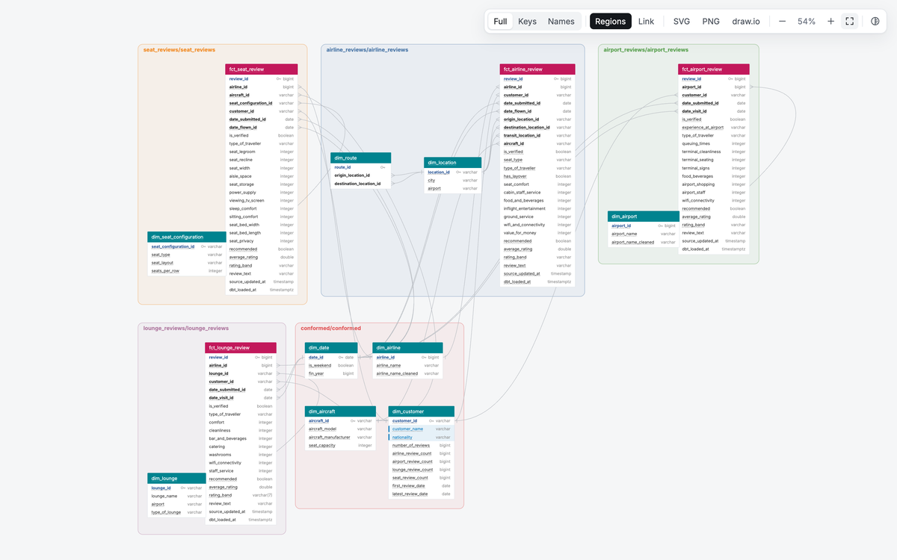
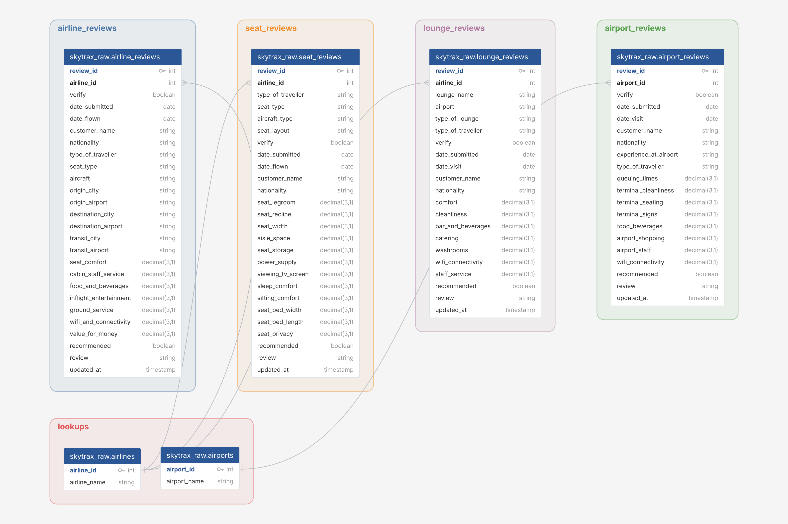
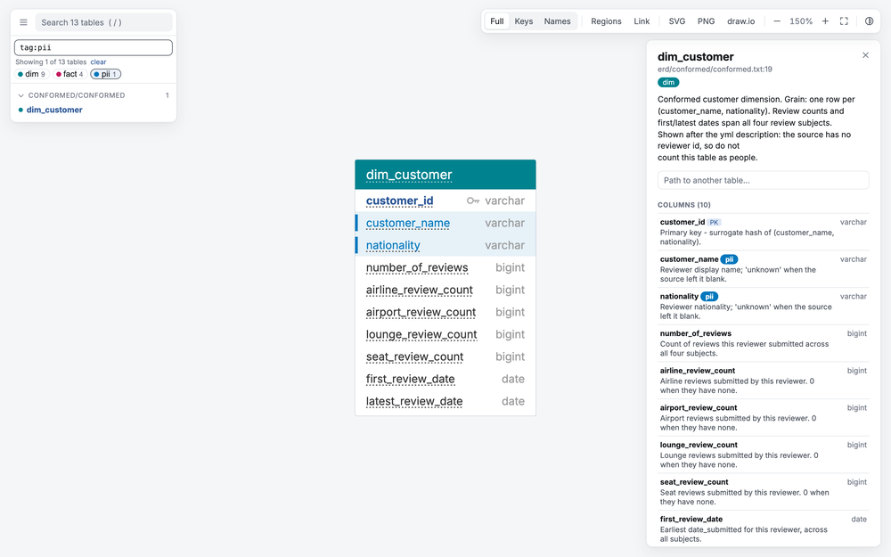
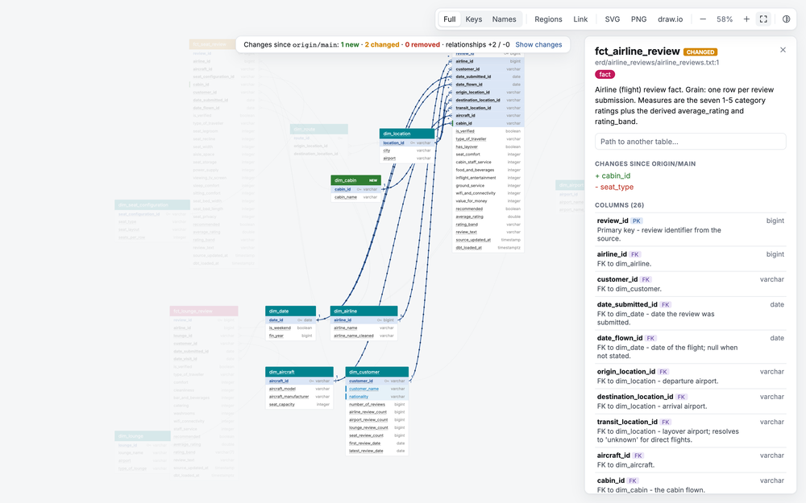
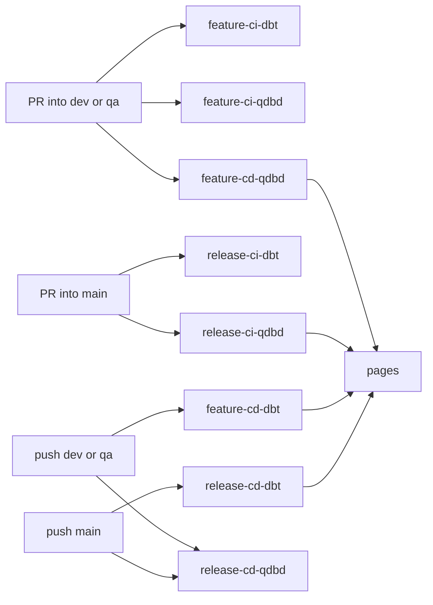
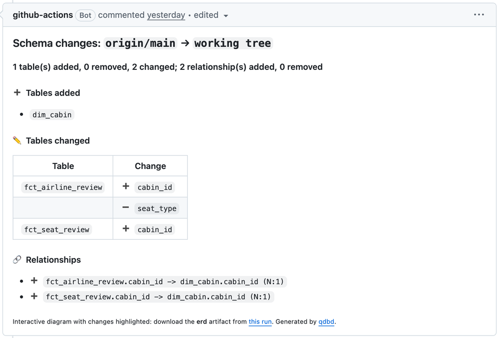

# qdbd-dbt-demo

A working demo of [qdbd](https://qdbd.dev/) on a real dbt project. Four star schemas on DuckDB, two hand-written diagrams, and a `# @dbt:` line in each that pulls descriptions, tags and column types straight from the dbt yml. CI checks both diagrams against the yml, every pull request gets a schema diff, and each environment publishes its own pages.

**Live diagrams:** [production](https://markphamm.github.io/qdbd-dbt-demo/) · [sources](https://markphamm.github.io/qdbd-dbt-demo/sources.html) · [qa vs main](https://markphamm.github.io/qdbd-dbt-demo/qa/) · [dev vs qa](https://markphamm.github.io/qdbd-dbt-demo/dev/) · [open pull requests](https://markphamm.github.io/qdbd-dbt-demo/pr/)

[](https://markphamm.github.io/qdbd-dbt-demo/)

_The production model diagram, built with `--by-group`: one shaded region per file under `erd/models/`, mirroring the folders under `models/`. Click any table for its dbt descriptions, types, tags and relationships._

[](https://markphamm.github.io/qdbd-dbt-demo/sources.html)

_The source diagram, `erd/sources/`, also built with `--by-group`. Six `skytrax_raw` tables. The review extracts point at `airlines` and `airports`._

The data is a sample of the Skytrax reviews from [skytrax_reviews_data](https://github.com/MarkPhamm/skytrax_reviews_data), modelled the same way: four star schemas on one shared set of dimensions. The CI/CD follows [dbt_duckdb_cicd_template](https://github.com/MarkPhamm/dbt_duckdb_cicd_template).

## What qdbd does

[qdbd](https://qdbd.dev/) keeps a database diagram as plain text in the repo — QuickDBD syntax or DBML — and builds it into one interactive HTML page. It checks the schema, lays it out, renders it, and compares versions. No database connection, no diagram-tool account, and no second copy of the schema to keep in sync.

For a dbt project, one line connects the two:

```text
# @dbt: ../..
```

qdbd reads the project's `.yml` and `.md` files directly and adds their descriptions, column types and tags to the diagram. No `manifest.json`, no `dbt parse`, no build. That is the whole integration used here; the [dbt guide](https://qdbd.dev/dbt/) covers the manifest route for projects that prefer it.

What that gives this repo:

- **The diagrams are reviewed like code.** `erd/models/` holds the star schemas. `erd/sources/` holds the six raw extracts. A model change and its diagram change land in the same pull request.
- **dbt stays the source of truth for documentation.** Descriptions, `pii` tags and column types come from the yml. The picture cannot quietly drift from the docs.
- **Drift fails the build.** `qdbd check --each --strict erd/models erd/sources` fails when a column exists on one side only, a type changes base type, or a table has no model.
- **A branch shows what merging it changes.** `qdbd diff` lists it, `qdbd build --by-group --diff-base` colours it, and the GitHub Action posts it on the pull request, one section per diagram.
- **The same schema answers questions.** `qdbd path` returns the shortest join and its SQL; `qdbd mcp` serves tables, keys and paths to an AI agent.

| I want to… | Command | In this repo |
|---|---|---|
| Browse and edit the model diagram | `qdbd serve --by-group erd/models` | dragged positions go to `erd/models/qdbd.layout.json` |
| Browse the source diagram | `qdbd serve --by-group erd/sources` | dragged positions go to `erd/sources/qdbd.layout.json` |
| Build a shareable page | `qdbd build --by-group erd/models -o erd.html` | GitHub Pages, `--by-group`, one page per environment |
| Catch diagram/yml drift | `qdbd check --each --strict erd/models erd/sources` | `feature-ci-qdbd` and `release-cd-qdbd` |
| See a branch's schema diff | `qdbd diff --base main erd/models` | pull-request comment and coloured diagram |
| Find a join | `qdbd path erd/models --from dim_customer --to fct_seat_review` | prints the shortest path and `FROM`/`JOIN` SQL |
| Export for a doc or slide | `qdbd export --by-group erd/models -o erd.svg` | PNG, SVG and draw.io |
| Let an agent read the schema | `qdbd mcp` | MCP over stdio |

### The yml, in the diagram

[](https://markphamm.github.io/qdbd-dbt-demo/#f=tag%3Apii&t=dim_customer&z=1.5&c=810%2C1140)

In the Filter box, `tag:pii` narrows 13 tables to `dim_customer`. Its table description, all ten column descriptions and the `varchar`/`bigint` types come from `models/conformed/_conformed__models.yml` and the `` blocks in `models/docs.md`. The `pii` tags tint `customer_name` and `nationality`; the same tags are what the filter matches.

### A branch shows what merging it changes

[](https://markphamm.github.io/qdbd-dbt-demo/qa/#t=fct_airline_review)

`/qa/` is built with `--by-group --diff-base main`. `dim_cabin` is green (new); `fct_airline_review` is amber (changed). Selecting the fact lists `+ cabin_id` and `- seat_type`; the banner counts the two new relationships. The same change is what `release-ci-qdbd` comments on the promotion pull request, in the `erd/models` section.

## Setup

Python 3.12 and [uv](https://docs.astral.sh/uv/). qdbd 0.6.11, the same pin as CI:

```bash
uv sync
uv tool install "quickdbd-cli==0.6.11"
uv run dbt deps
uv run dbt build
qdbd serve --by-group erd/models
```

`profiles.yml` is committed because DuckDB has no credentials. dbt reads it from the project directory.

## Layout

```
data/raw/            Skytrax sample, read in place by a dbt source (read_csv)
models/
  staging/           stg_skytrax__*         one per raw file, re-ingested duplicates removed
  intermediate/      int_*_reviews_cleaned  nulls to 'unknown', casts, normalised spellings
  conformed/         dim_airline, dim_customer, dim_aircraft, dim_date
  airline_reviews/   fct_airline_review, dim_location
  airport_reviews/   fct_airport_review, dim_airport
  lounge_reviews/    fct_lounge_review, dim_lounge
  seat_reviews/      fct_seat_review, dim_seat_configuration
erd/models/         the model diagram, one folder per star schema, mirroring models/
erd/sources/        the source diagram, one file per extract, compiled as one schema
scripts/sample_raw.py  rebuilds data/raw/ from a skytrax_reviews_data checkout
```

Each star schema is a folder straight under `models/`, so it is also a schema in prod (`conformed`, `lounge_reviews`, ...). [GLOSSARY.md](docs/GLOSSARY.md) defines review, reviewer, rating band and the rest.

## Data model

Grain of every fact: one row per review submission. Row counts are for the committed sample.

| Folder | Table | Rows | |
|---|---|---:|---|
| conformed | `dim_airline` | 595 | Airline lookup, shared by airline, lounge and seat reviews |
| conformed | `dim_customer` | 1,533 | Reviewer proxy (name + nationality), with a review count per subject |
| conformed | `dim_aircraft` | 44 | Model, manufacturer, seat capacity |
| conformed | `dim_date` | 21,130 | Calendar and fiscal spine covering every date in every fact |
| airline_reviews | `fct_airline_review` | 500 | 7 category ratings, origin / destination / transit location |
| airline_reviews | `dim_location` | 334 | City + airport code, role-played three times by the fact |
| airport_reviews | `fct_airport_review` | 500 | 8 category ratings |
| airport_reviews | `dim_airport` | 1,004 | Airport lookup |
| lounge_reviews | `fct_lounge_review` | 482 | 7 category ratings |
| lounge_reviews | `dim_lounge` | 403 | Lounge, airport and access tier |
| seat_reviews | `fct_seat_review` | 483 | 12 category ratings |
| seat_reviews | `dim_seat_configuration` | 29 | Cabin, normalised layout, seats per row |

`scripts/sample_raw.py` keeps the 480 most recent submissions per subject, plus up to 20 that the source stored twice, so the staging dedup still has something to remove. One seat-review test warns on purpose: three reviews in the source carry a 1970 submission date.

Skytrax reviews are self-reported. Anything built on them is directional, not population-level.

## The dbt link: `# @dbt:`

Two diagrams. Pass each root on its own. A glob of `erd/*/` would make every star-schema folder its own schema, and every fact's foreign key to `dim_customer` would fail.

```
erd/
├── models/                                  one schema, built with --by-group
│   ├── conformed/conformed.txt              # @dbt: ../../..   <- the model link
│   ├── airline_reviews/airline_reviews.txt
│   ├── airport_reviews/airport_reviews.txt
│   ├── lounge_reviews/lounge_reviews.txt
│   ├── seat_reviews/seat_reviews.txt
│   └── qdbd.layout.json
└── sources/                                 one schema, built with --by-group
    ├── lookups.txt                          # @dbt: ../..      airlines, airports
    ├── airline_reviews.txt
    ├── airport_reviews.txt
    ├── lounge_reviews.txt
    ├── seat_reviews.txt
    └── qdbd.layout.json
```

`# @dbt:` names the folder holding `dbt_project.yml`, relative to the file it sits in. qdbd then reads the project's yml and `.md` files directly and adds them to the diagram. No `manifest.json`, no `dbt parse`, no build.

One line covers a whole diagram. `qdbd check erd/models` compiles every `.txt` under that folder as one schema, so `fct_lounge_review` can point at `dim_customer`. `qdbd check --each erd/models erd/sources` checks the two diagrams separately, which is what CI and the pre-commit hook run. `--each erd/models/*/` would split the star schemas apart.

Tables match dbt models or sources by name, ignoring case. Columns match by name. Your `.txt` is never changed. The source yml lists tables and no columns, so the columns written under `erd/sources/` are not compared.

| What qdbd adds | Where to see it here |
|---|---|
| Table descriptions | Every table. `dim_customer` shows its yml description first, then the comment written above it in `erd/models/conformed/conformed.txt` |
| Column descriptions | Every column with one. `average_rating` and `rating_band` come from `` blocks in `models/docs.md` |
| Column types | Every column the `.txt` leaves untyped is filled from `data_type`. `fct_lounge_review.rating_band` is typed `varchar(7)` in the file, so it keeps that |
| Tags | `customer_name` and `nationality` are tagged `pii` in `models/conformed/_conformed__models.yml`, so their rows are tinted. Type `tag:pii` in the Filter box |

Header colours come from the names: `dim_` and `fct_` are tagged and coloured with no config.

### Drift warnings

Anything the `.txt` and the yml disagree on becomes a `dbt:` warning: a column on one side only, a type with a different base type, a table with no dbt model. Add `has_shower` under `staff_service` in `erd/models/lounge_reviews/lounge_reviews.txt`, then:

```console
$ qdbd check erd/models
erd/models/lounge_reviews/lounge_reviews.txt:18: warning: dbt: column 'has_shower' is not in the yml for 'fct_lounge_review' (models/lounge_reviews/_lounge_reviews__models.yml:26)
No errors found (1 warning(s)).
$ qdbd check --strict erd/models; echo $?
1
```

`feature-ci-qdbd` runs the strict check on a pull request into `dev` or `qa`. `release-ci-qdbd` runs it, and posts the diff, on a pull request into `main`. `release-cd-qdbd` runs it again on every push.

On `main`, `dim_route` in `erd/models/airline_reviews/airline_reviews.txt` is planned, not built, and `# @dbt: none` above it keeps the check quiet. On this branch it is a model, so the line is gone and the yml describes it.

### Commands

```bash
qdbd serve --by-group erd/models          # then open dim_customer
qdbd check --each --strict erd/models erd/sources
qdbd build --by-group erd/models -o /tmp/erd.html
qdbd build --by-group erd/models -s group:lounge_reviews -o /tmp/lounge.html
qdbd path erd/models --from dim_customer --to fct_seat_review
```

`qdbd path` prints the path and the SQL, so the answer can go straight into a query:

```console
$ qdbd path erd/models --from dim_customer --to fct_seat_review
dim_customer -> fct_seat_review: 1 join(s)
  dim_customer.customer_id -> fct_seat_review.customer_id (1:N)

FROM dim_customer
JOIN fct_seat_review ON fct_seat_review.customer_id = dim_customer.customer_id
```

`--by-group` lays each file out as its own shaded region and ignores saved positions. Pages builds every diagram that way. `qdbd layout --by-group erd/models` writes the same arrangement into `erd/models/qdbd.layout.json` for the next `qdbd serve`. Region labels are the file's path under the root you passed, such as `lounge_reviews/lounge_reviews`.

## Environments

One `database/database.duckdb`. The target chooses the schema.

| Target | Used by | Schema |
|---|---|---|
| `dev` (default) | your laptop, and `feature-cd-dbt` on the `dev` branch | `dev`, everything flat |
| `qa` | `feature-cd-dbt` on the `qa` branch | `qa`, everything flat |
| `ci` | pull requests | `ci_local`, or `ci_pr_<n>` when `DBT_CI_SCHEMA` is set |
| `prod` | `release-cd-dbt` on `main` | `staging`, `intermediate`, `conformed`, and one per subject |

`macros/generate_schema_name.sql` is what makes prod split and the others stay flat. dbt's built-in macro would concatenate instead (`dev_staging`).

## Branches and promotion

Changes move `feature → dev → qa → main`, one pull request per hop.

| Branch | Ahead of the next one by | Pages |
|---|---|---|
| `main` | (production) | [`/`](https://markphamm.github.io/qdbd-dbt-demo/) and [`/sources.html`](https://markphamm.github.io/qdbd-dbt-demo/sources.html) |
| `qa` | `dim_cabin`, a conformed dimension, with `cabin_id` on the airline and seat facts | [`/qa/`](https://markphamm.github.io/qdbd-dbt-demo/qa/), coloured against `main` |
| `dev` | `dim_route` built as a model, with `route_id` on `fct_airline_review` | [`/dev/`](https://markphamm.github.io/qdbd-dbt-demo/dev/), coloured against `qa` |

On `qa` or `dev`:

```bash
qdbd diff --base main erd/models
qdbd build --by-group erd/models --diff-base main -o /tmp/erd-diff.html
```

## CI/CD

Nine workflows, no secrets. Eight are named `{feature|release}-{ci|cd}-{dbt|qdbd}`. `feature` is `dev` and `qa`. `release` is `main`. `ci` is a pull request. `cd` is a push, except `feature-cd-qdbd`, which is the pull-request preview. The ninth is `pages`.



A pull request into `dev` or `qa` runs three jobs. A pull request into `main` runs two. A push runs the matching dbt CD plus `release-cd-qdbd`. The dbt jobs and the qdbd jobs share nothing.

| Workflow | Runs on | Does |
|---|---|---|
| `feature-ci-dbt` | pull request into `dev` or `qa` | slim CI: `dbt build --target ci --select state:modified+ --defer` against that base's last green dbt CD |
| `release-ci-dbt` | pull request into `main` | the same slim CI, against `release-cd-dbt` |
| `feature-ci-qdbd` | pull request into `dev` or `qa` | `qdbd check --each --strict erd/models erd/sources`. No comment |
| `feature-cd-qdbd` | pull request into `dev` or `qa` | one comment, a section per diagram, and the coloured HTML as the `erd` artifact |
| `release-ci-qdbd` | pull request into `main` | the same comment and artifact, against `main` |
| `feature-cd-dbt` | push to `dev` or `qa` | `dbt build` for that target, then upload `dbt-artifacts` |
| `release-cd-dbt` | push to `main` | `dbt build --target prod`, then upload `dbt-artifacts` |
| `release-cd-qdbd` | push to `dev`, `qa`, or `main` | the same strict qdbd check. No comment |
| `pages` | after `feature-cd-qdbd`, `release-ci-qdbd`, `feature-cd-dbt`, or `release-cd-dbt` | rebuild `/`, `/qa/`, `/dev/`, and `/pr/N/` with `qdbd build --by-group`, then deploy |

`/`, `/qa/`, and `/dev/` are the model diagram (`index.html`). `sources.html` beside each is the source diagram. `/qa/` is coloured against `main`, `/dev/` against `qa`, and `/pr/N/` against that pull request's base. `qdbd build --site` is not used: it would replace `index.html` with a link page.

[](https://github.com/MarkPhamm/qdbd-dbt-demo/pull/2)

*The comment on the earlier [`qa → main` pull request](https://github.com/MarkPhamm/qdbd-dbt-demo/pull/2), when there was one diagram. `feature-cd-qdbd` and `release-ci-qdbd` now post one section for `erd/models` and one for `erd/sources`. The shot of that comment lands with the first pull request that produces it.*

### Set it up

These are the steps this repo took, in order. They work the same in a copy of it.

1. **Put the files in place.** You need:
   - the nine files in `.github/workflows/`
   - the `dev`, `qa`, `ci` and `prod` targets in `profiles.yml`
   - `macros/generate_schema_name.sql`
   - `erd/models/` and `erd/sources/`, each with one `# @dbt:` line pointing at the folder that holds `dbt_project.yml`
   - `.pre-commit-config.yaml`

   Keep `quickdbd-cli==0.6.11` in `pages.yml` and `MarkPhamm/quickdbd-cli@v0.6.11` in the qdbd workflows on the same version.

2. **Check locally before pushing:**

   ```bash
   uv run dbt deps && uv run dbt build
   qdbd check --each --strict erd/models erd/sources
   ```

3. **Push the branches in promotion order**, so each one runs its dbt CD once and has artifacts before a pull request asks for them:

   ```bash
   git push origin main          # release-cd-dbt
   git push -u origin qa         # feature-cd-dbt
   git push -u origin dev        # feature-cd-dbt
   gh run list --workflow release-cd-dbt.yml
   gh run list --workflow feature-cd-dbt.yml
   ```

4. **Turn on Pages**, once, with the source set to GitHub Actions:

   ```bash
   gh api -X POST repos/<owner>/<repo>/pages -f build_type=workflow
   gh workflow run pages.yml
   ```

   Or use **Settings → Pages → Source → GitHub Actions**. Until then, `pages.yml` builds the sites and its `deploy` job fails with `Ensure GitHub Pages has been enabled`. `workflow_run` uses the `pages.yml` on `main`, so `/sources.html` and `/pr/N/` go live when this file reaches `main`.

5. **Open the promotion pull requests:** `dev → qa` and `qa → main`. A pull request into `dev` or `qa` gets `feature-ci-dbt`, `feature-ci-qdbd`, and `feature-cd-qdbd`. A pull request into `main` gets `release-ci-dbt` and `release-ci-qdbd`.

6. **Optional:** in **Settings → Branches**, protect `dev`, `qa` and `main`, and require those checks.

### Day to day

1. Branch from `dev`. Change a model and its yml. Update the file under `erd/models/` in the same commit. A source change updates the matching file under `erd/sources/`.
2. Run `qdbd check --each --strict erd/models erd/sources`. It fails if a diagram and the yml disagree, and so does CI. The pre-commit hook runs the same command.
3. Open a pull request into `dev`. Read the qdbd comment. Merge.
4. `feature-cd-dbt` rebuilds `dev`, and `pages` republishes `/dev/` and `/dev/sources.html`, coloured against `qa`, with `--by-group`.
5. Promote with a pull request `dev → qa`, then `qa → main`. Each merge rebuilds that environment and its pages.

A fix made straight on `main` goes back down with a merge, not a rebase, so open pull requests keep their diffs:

```bash
git checkout qa && git merge main && git push
git checkout dev && git merge qa && git push
```

### Why it is built this way

- **Slim CI defers to the base branch, not to prod.** A pull request into `qa` is checked against what `qa` already has. `feature-cd-dbt` and `release-cd-dbt` upload under the same artifact name, and the dbt CI workflows pick the file that matches the base branch.
- **The qdbd check shares nothing with slim CI.** The yml link needs no build, so the diagram check stays green even when no dbt CD has run yet.
- **`pages` runs after the preview and the dbt CD, not on every push.** A `workflow_run` job runs on the default branch, and the `github-pages` environment only accepts deploys from the default branch. Every deploy rebuilds every folder, so a push to `dev` never wipes `/qa/`.
- **Pages uses `--by-group`.** Each file is a shaded region. Saved positions in `qdbd.layout.json` are for `qdbd serve`. The published page lays the groups out fresh.
- **One DuckDB file per run.** CI downloads the base branch's `database.duckdb` and writes into its own `ci_pr_<n>` schema in that copy. Nothing it does reaches an environment.

### On a real warehouse

Only the dbt half changes; the qdbd half stays as it is.

- `profiles.yml`: point each target at the warehouse, with `env_var("DBT_PASSWORD")` and the like, and store the values as GitHub secrets.
- `feature-cd-dbt.yml` and `release-cd-dbt.yml`: upload only `manifest.json`. The warehouse already holds the data.
- `feature-ci-dbt.yml` and `release-ci-dbt.yml`: drop the `database.duckdb` copy. `--defer --state` then reads the deferred relations from the base environment's schemas.
- Give CI credentials that cannot write to `prod`.

## Refreshing the sample

```bash
uv run python scripts/sample_raw.py ../skytrax_reviews_data/data/raw
```

## Elsewhere in qdbd

This repo does not set these up. The docs do:

- [Importing a dbt manifest](https://qdbd.dev/dbt/) instead of linking the yml
- [MCP](https://qdbd.dev/mcp/) for agents
- [Sharing a gist](https://qdbd.dev/sharing/)
- [DBML](https://qdbd.dev/dbml/)
- [PNG, SVG and draw.io](https://qdbd.dev/exports/)
- [VS Code](https://qdbd.dev/vscode/)

This repo is also the [Skytrax demo on qdbd.dev](https://qdbd.dev/demo/skytrax/#t=dim_customer).
